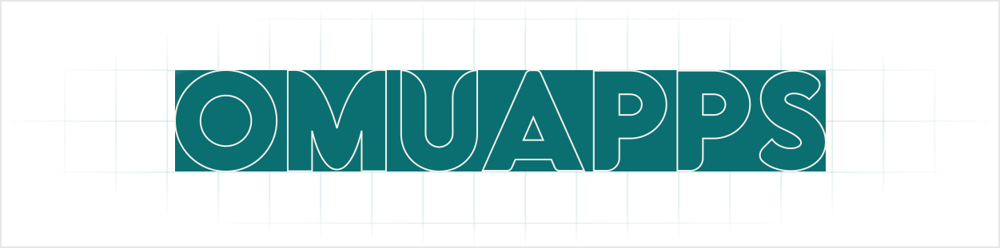

## OMUAPPSについて

OMUAPPSは、アプリ間の連携やブラウザだけでは実現できない機能を厳格に制限された権限のもと提供をするAPIアプリケーションおよびそのAPIを利用するアプリケーションを提供するプラットフォームです。

## 開発

OMUAPPSの開発環境を構築する方法です。

この手順はvscodeを使用することを前提としています。

### 必要なもの

必要なものをインストールしてください。

- Install [Rust](https://www.rust-lang.org/)
- Install [bun](https://bun.sh/)

OBSプラグインをビルドするときは、次のものも必要です。

- Install [CMake](https://cmake.org/) 3.28以上
- Install [Visual Studio 2022](https://visualstudio.microsoft.com/)（C++によるデスクトップ開発）

### セットアップ

`bun i`を実行してください。

```bash
bun i
```

OBSプラグインは`packages-cpp/plugin-obs`で次を実行してビルドします。

```bash
cmake --preset windows-x64
cmake --build --preset windows-x64
cmake --install build_x64 --prefix release --config RelWithDebInfo
```

### 起動

VS Codeでは、実行とデバッグから複合起動構成の [ All ] を選択して起動してください。
